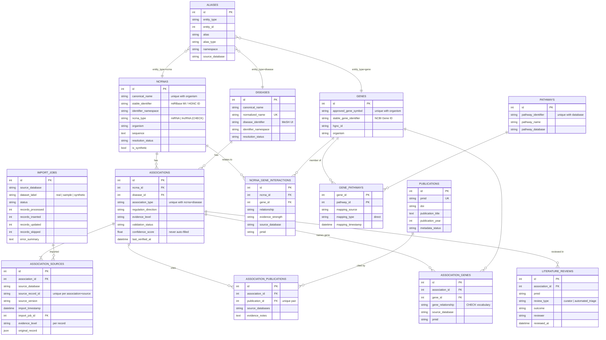

# Database schema

The schema is defined with SQLAlchemy models in `backend/app/models/` and created through the Alembic
migration in `backend/migrations/versions/`. The same migration runs on SQLite (development) and PostgreSQL
(deployment); constraint names follow a fixed naming convention so migrations stay portable.

## Entity-relationship diagram

`external_cache` (namespace, cache_key, JSON value) stores MeSH lookups and is not shown.

## Tables

| Table | Purpose | Key constraints |
|---|---|---|
| `ncrnas` | One row per miRNA locus or lncRNA per organism | `UNIQUE(canonical_name, organism)`, `CHECK ncrna_type IN ('miRNA','lncRNA')` |
| `diseases` | Disease concepts as named by sources | `UNIQUE(normalized_name)`; MeSH UI when exactly resolvable |
| `genes` | Genes, normalized to HGNC | `UNIQUE(approved_gene_symbol, organism)` |
| `aliases` | Synonyms, previous symbols, source spellings, cross-reference IDs | `UNIQUE(entity_type, entity_id, alias, source_database)` |
| `associations` | ncRNA–disease relationship of one type | `UNIQUE(ncrna_id, disease_id, association_type)` |
| `association_sources` | One row per supporting source record (provenance) | `UNIQUE(association_id, source_database, source_record_id)` |
| `publications` | PubMed metadata, once per PMID | `UNIQUE(pmid)` |
| `association_publications` | Association ↔ publication links | `UNIQUE(association_id, publication_id)` |
| `association_genes` | Genes named by a source record for a specific association | `UNIQUE(association_id, gene_id, gene_relationship, source_database)`, CHECK on relationship |
| `ncrna_gene_interactions` | General (not disease-specific) ncRNA→gene relationships | `UNIQUE(ncrna_id, gene_id, relationship, source_database, pmid)` |
| `pathways` | KEGG pathways | `UNIQUE(pathway_database, pathway_identifier)` |
| `gene_pathways` | Direct gene→pathway membership from KEGG | composite PK `(gene_id, pathway_id)` |
| `literature_reviews` | Curator decisions and automated triage hints | FK to association |
| `import_jobs` | Audit trail of every import | — |

Foreign keys cascade on delete from entity to association to provenance. In SQLite, `PRAGMA foreign_keys=ON`
is set on every connection, so the constraints are enforced there as well.

## Design notes and deviations from the original specification

* **Publications are normalized.** The specification put bibliographic fields on `association_publications`.
  Here they live once in `publications`, and `association_publications` is the link table. This prevents
  duplicate publication records and lets one PMID support many associations.
* **`ncrna_gene_interactions` was added.** General miRNA targets (for example from miRTarBase) are not
  disease-specific. Storing them in `association_genes` would present them as disease evidence, so they are
  kept separate.
* **Per-record evidence.** `association_sources` stores the evidence level and regulation direction of each
  source record. The association-level values are derived from these records and can be recomputed at any time.
* **`is_synthetic`** flags exist on entities and associations so that synthetic demonstration data can never be
  mixed silently into statistics. The shipped sample dataset contains no synthetic records.
