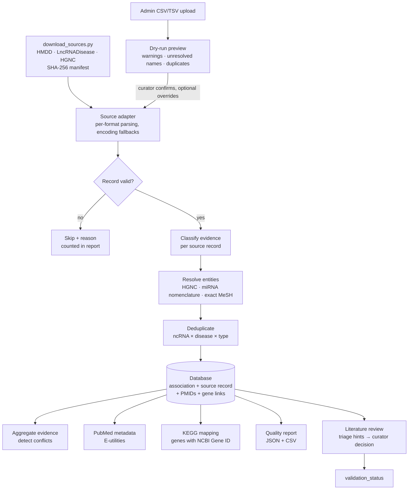
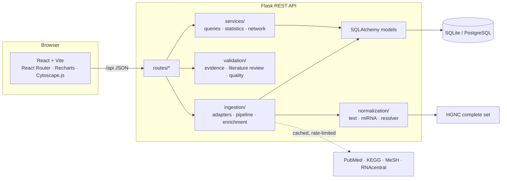

# Methodology

## Pipeline overview

## Architecture

## 1. Collection

`scripts/download_sources.py` downloads the HMDD, LncRNADisease and HGNC files from their documented download
locations. It resumes dropped connections with HTTP Range requests and records the URL, size, SHA-256 and
timestamp in `data/raw/manifest.json`. Each import creates an `import_jobs` row. Each source record is stored
verbatim (`association_sources.original_record`) with its source name, record ID, version and import job.

Source records without a native ID get a deterministic SHA-1 content hash. Re-importing the same file is
therefore idempotent: it reports `unchanged` and writes nothing.

## 2. Standardization

| Entity | Rule |
|---|---|
| Text | Unicode NFKC, whitespace collapsed, wrapping quotes removed, Unicode dashes unified. Case is preserved. |
| miRNA | Parsed with miRBase nomenclature; stored at precursor level (`hsa-mir-125b-1`). The HGNC symbol is derived (`MIR125B1`, `MIR1-1`, `MIRLET7A1`). If the symbol exists in HGNC, the canonical name is HGNC's recorded miRBase ID and the stable identifier is the miRBase accession. Mature names map to the precursor only when exactly one locus exists. Names without a locus that match several loci (`hsa-mir-16` → `MIR16-1`, `MIR16-2`) are flagged **ambiguous** and not merged. |
| lncRNA | HGNC approved symbol, then a *unique* previous symbol (`LINC00152` → `CYTOR`), then a *unique* alias. Ambiguous symbols are not resolved, and a symbol that resolves to a protein-coding gene is not merged. |
| Gene | Same HGNC rules; an Entrez ID, when provided, takes precedence. The stable ID is the NCBI Gene ID, which KEGG uses. |
| Disease | MeSH descriptor assigned only on an **exact** label match (the lookup is cached). Unmatched names stay unresolved; for example, `Hepatocellular carcinoma` is a MeSH entry term, not a descriptor heading. |
| Organism | Non-human records keep their species and are not resolved against HGNC. They are excluded from human statistics and labelled in the UI; `--human-only` skips them. |

The original spelling of every normalized entity is kept in `aliases` with its source.

## 3. Deduplication

* **ncRNA:** `(canonical name, organism)`, also matched on the stable identifier.
* **Disease:** normalized name, also matched on the MeSH UI.
* **Gene:** `(approved symbol, organism)`, also matched on the NCBI Gene ID.
* **Association:** `(ncRNA, disease, association type)`.
* **Source record:** `(association, source, record ID)`.
* **Publication:** PMID.

Merges append source records and PMIDs; nothing is overwritten. Exact duplicates within a file are counted
and skipped. Names that merely look similar are never merged.

## 4. Evidence classification

Each source record is classified on its own content, and the association level is derived from all of its records.

| Source | Rule |
|---|---|
| HMDD | `tissue_expression_*`, `circulation_biomarker_*`, `genetics_*`, `epigenetics`, `target gene`, `transcription factor target`, `lncRNA target`, `therapeutic target` with a PMID → `experimental`; `other` → `literature_unclear`; no PMID → `unverified`. The category suffix gives the direction (`up`/`down`/`ns`). |
| LncRNADisease | A validation method with a PMID → `experimental`; a PMID without a method → `literature_unclear`. The dysfunction pattern gives the type (`Expression[highly expressed]` → expression/up, `Interaction(...)` → regulatory, `Mutation` → genetic variant, …). |
| Upload | A declared level is accepted only if justified: `experimental` without a PMID or method is downgraded to `unverified` with a warning. |
| Aggregation | `conflicting` if records report both `up` and `down` for the same ncRNA, disease and type; otherwise the strongest of `experimental` > `literature_unclear` > `computational_prediction` > `unverified`. |

`confidence_score` is never populated, because no scoring methodology is implemented.

## 5. Literature review

1. `validate_associations.py triage` (or the admin API) gathers the publications, fetches missing metadata and
   records **automated triage hints**: whether the title/abstract mention the ncRNA (including name variants
   such as `miR-21` or `microRNA-21`) and the disease (including un-inverted MeSH headings). Hints set the
   status to `under_review` at most.
2. A curator reads the publication and records an outcome (`supports_direct_experimental`, `supports_indirect`,
   `prediction_only`, `does_not_support`, `insufficient`, `conflicting`), the evidence type, notes and
   reviewer name. The review date is stored. Worksheets can be exported and re-imported as CSV.
3. Status derivation:
   * `curator_confirmed` requires at least one direct-experimental review and no "does not support" review.
   * `curator_rejected` means every review says "does not support".
   * `conflicting` means the reviews disagree.
   * Any other set of reviews gives `insufficient_evidence`.

The sample's curated rows were checked against PubMed **abstracts** while the dataset was built. That check is
documented in each row's evidence text, but it is *not* recorded as a curator review, because full texts were
not reviewed.

## 6. KEGG mapping

`map_pathways.py` sends the NCBI Gene ID of every human gene to `link/pathway/hsa:<id>` (batches of 10,
~2.5 requests/s) and fetches pathway names from `list/pathway/hsa`. The resulting `gene_pathways` rows are
direct mappings with source and timestamp. Pathways shown for ncRNAs, diseases and associations are
**inferred via genes** and labelled as such. Genes without an ID, or with no KEGG pathway, are reported. If
KEGG is unavailable, the sample cache (`kegg_cache.json`, with its retrieval date) is used.

## 7. Network generation

* **ncRNA–disease edges:** one per association, carrying evidence level, review status, sources and PMID count.
* **ncRNA–gene edges:** stored relationships, at most 25 per ncRNA, carrying relationship type, strength, methods and PMIDs.
* **gene–disease edges:** drawn only when a source record names that gene for that association.

The most-cited associations are shown first, up to `max_associations`; the response says when the graph is truncated.

## 8. Quality control

Each import writes `data/reports/import_job_<id>_<timestamp>.json` and `.csv` with:

* raw and valid records, inserted/merged/unchanged/skipped counts, and skip reasons;
* duplicates within the file and records merged into existing associations;
* non-human records and records missing a PMID;
* unique ncRNAs, diseases, genes and associations;
* unresolved RNA names, disease names and gene identifiers (with lists);
* associations missing publication evidence or provenance;
* conflicting associations;
* warnings, including encoding fallbacks.

## 9. Known limitations

* Evidence levels inherit the curation quality and coverage of HMDD and LncRNADisease.
* HMDD precursor names without a locus remain ambiguous; mature-arm specificity (5p/3p) is lost at precursor level.
* Disease names that are not MeSH descriptor headings remain unresolved; no ontology reasoning (DO/MONDO) is applied.
* No bulk miRNA–target resource is imported by default, so gene coverage depends on curated and uploaded data.
* KEGG mappings and PubMed metadata reflect their retrieval dates.
* The admin token is a single shared secret, suitable for an academic deployment, not multi-user access control.
